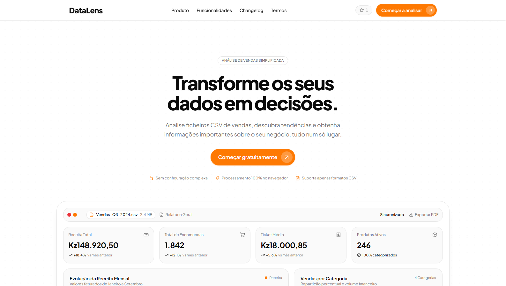

# DataLens

**DataLens** is a sales CSV file analyzer. Upload a file, validate its data, and view a summary with key metrics, revenue by category, and the best-selling products. Each analysis is stored and available in the analysis history.

> **Status:** Under development.

## Features

- CSV upload with validation of structure, types, and values.
- Summary of records, total quantity, revenue, and average value per row.
- Revenue breakdown by category.
- Top 5 products ranked by quantity sold.
- Persisted analysis history (PostgreSQL via API).
- Responsive interface in Portuguese.
- GitHub stars badge in the headers (server-side, cached).

## Tech Stack

| Area | Technologies |
|---|---|
| **API** | FastAPI, Pandas, SQLAlchemy, Alembic, PostgreSQL |
| **Web** | Next.js 16 (App Router), TypeScript, Tailwind CSS, Recharts |
| **Development** | Docker Compose (API + PostgreSQL), pnpm dev (web) |
| **Deployment** | Render (API via Docker), Vercel (web), managed PostgreSQL |

## CSV Format

The uploaded file must meet the following requirements:

- File extension: `.csv`
- Encoding: UTF-8, with or without BOM.
- Maximum file size: **50 MB**.
- Maximum number of records: **50,000 rows**.

### Required columns

| Column | Validation rule |
|---|---|
| `date` | Valid date in `YYYY-MM-DD` format |
| `product` | Non-empty text |
| `category` | Non-empty text |
| `quantity` | Integer between 1 and 100,000 |
| `price` | Number between 0 and 10,000,000 Kz |

### Validation rules

- Every required column must be present.
- All values must follow their respective validation rules.
- If any row is invalid, the entire file is rejected.
- No automatic corrections are performed.
- The API returns up to **20 validation errors**, including the row, column, and error message.

Revenue is calculated for each row using:

```text
revenue = quantity * price
```

### Example CSV

Available at [`samples/sales.csv`](./samples/sales.csv):

```csv
date,product,category,quantity,price
2026-01-02,Telemóvel,Tecnologia,3,85000
2026-01-03,Auriculares,Acessórios,10,7500
2026-01-03,Teclado,Acessórios,5,12000
2026-01-05,Monitor,Tecnologia,2,150000
2026-01-06,Rato,Acessórios,8,4500
2026-01-07,Telemóvel,Tecnologia,1,85000
```

### Expected analysis

The example CSV produces the following results:

| Metric | Result |
|---|---:|
| Total records | 6 |
| Total quantity | 29 |
| Total revenue | 811,000 Kz |
| Average value per row | 135,166.67 Kz |

**Revenue by category:**

| Category | Revenue |
|---|---:|
| Technology | 640,000 Kz |
| Accessories | 171,000 Kz |
| **Total** | **811,000 Kz** |

Products are ranked by total quantity sold.

## Quick Start

### Prerequisites

- Docker and Docker Compose (API and PostgreSQL).
- Node.js 20+ and pnpm (web).
- Python 3.11+ and a virtual environment (optional, only for running the API outside Docker).

### 1. API (Docker Compose)

The API is packaged as a Docker image and can be deployed to Render without modifications.

For local development:

```bash
# From the project root

cp api/.env.example api/.env
# Configure DATABASE_URL and other environment variables

docker compose up --build api
```

Available endpoints:

| Service | URL |
|---|---|
| API | http://127.0.0.1:8000 |
| API Documentation | http://127.0.0.1:8000/docs |
| Health Check | http://127.0.0.1:8000/health |

To run the entire stack (API + PostgreSQL + web):

```bash
docker compose up --build
```

### 2. Web (Local Development)

```bash
cd web

pnpm install

cp .env.example .env.local

pnpm dev
```

Configure `web/.env.local`:

```env
NEXT_PUBLIC_API_BASE_URL=http://127.0.0.1:8000

# Optional: increases the GitHub API rate limit
GITHUB_TOKEN=ghp_...
```

The web application will be available at:

http://localhost:3000

### 3. API Without Docker (Optional)

Useful when running tests directly on your machine without rebuilding the Docker image.

```bash
cd api

python -m venv .venv

# Linux/macOS
source .venv/bin/activate

# Windows 
# .venv\Scripts\activate

# Windows (Powershell)
# .\.venv\Scripts\Activate.ps1

pip install -r requirements.txt

cp .env.example .env
# Configure DATABASE_URL

alembic upgrade head

uvicorn app.main:app --host 127.0.0.1 --port 8000 --reload
```

## API Reference

### Endpoints

| Method | Route | Description | Success |
|---|---|---|---|
| `POST` | `/api/analyses/upload` | Uploads a CSV, validates its contents, calculates metrics, and saves the analysis. Uses `multipart/form-data` with the `file` field. | `201` |
| `GET` | `/api/analyses` | Lists analyses from newest to oldest. | `200` |
| `GET` | `/api/analyses/{id}` | Returns a complete analysis. | `200` |
| `DELETE` | `/api/analyses/bulk` | Deletes a set of analyses by IDs. | `204` |
| `DELETE` | `/api/analyses/{id}` | Deletes a single analysis. | `204` |
| `GET` | `/health` | Health check. | `200` |
| `GET` | `/docs` | FastAPI OpenAPI documentation. | `200` |

### Expected Error Responses

| Scenario | HTTP Status |
|---|---:|
| File is not `.csv` | `415` |
| File exceeds 50 MB | `413` |
| Empty, malformed, or invalid CSV data | `422` |
| Analysis not found | `404` |

Validation errors include a message and up to 20 detailed entries containing:

- Row number.
- Column name.
- Validation reason.

**Note:** Row counting starts at the header. Blank lines may cause the reported row number to differ from the physical line number in the original file.

## Project Structure

```text
datalens/
│
├── api/                       # Backend API
│   ├── app/                   # Application logic
│   ├── alembic/               # Database migrations
│   ├── tests/                 # API and analyzer tests
│   │── Dockerfile
│	│── docker-compose.yml     # Local development stack
│
├── web/                       # Next.js application
│   ├── app/                   # App Router routes
│   │   └── (app)/             # Authenticated application shell
│   │
│   ├── components/            # UI, landing, pages, site and app
│   ├── lib/                   # Utilities (GitHub, etc.)
│   ├── services/              # API service layer
│   │   └── analyses.service.ts
│   └── shared/                # Shared types and configuration
│       ├── analysis.ts
│       └── api.config.ts
│
├── samples/                   # Sample CSV and invalid files


```

## Testing

### API

Analyzer tests run without HTTP requests or a database.

Run them inside the Docker container (recommended):

```bash
docker compose exec api pytest
```

Alternatively, run them locally:

```bash
cd api
pytest
```

Endpoint tests require the test database configuration defined by the project.

### Web

Run linting:

```bash
cd web
pnpm lint
```

Run the production build:

```bash
pnpm build
```

## Scope and Roadmap

### Completed

- [x] CSV upload.
- [x] CSV structure and data validation.
- [x] Sales metrics calculation.
- [x] Revenue breakdown by category.
- [x] Top 5 products by quantity sold.
- [x] Persisted analysis history.
- [x] API integration with the dashboard, analysis, and history pages.

### Pending

- [ ] Implement delete actions in the UI:
  - Delete a single analysis (`DELETE /api/analyses/{id}`).
  - Delete multiple analyses (`DELETE /api/analyses/bulk`).
- [ ] Replace the hardcoded landing dashboard preview with a real screenshot.

## Out of Scope

The following features are intentionally excluded from the current project scope:

- Machine learning.
- Sales forecasting.
- Configurable dashboards.
- File formats other than CSV.
- PDF export.
- User accounts and authentication.
- Permissions and role management.
- Background processing.

---

**DataLens**  
Sales data analysis through a simple CSV workflow.

© 2026 Manuel Jaime. All rights reserved.
